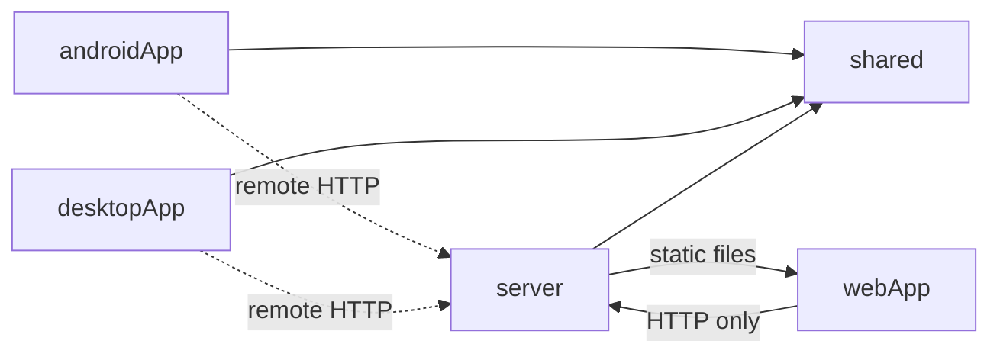
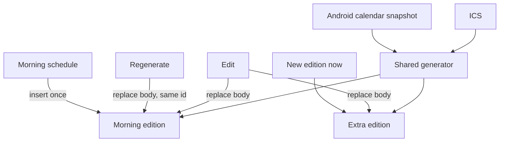

# Architecture Spine — Daily newspaper

## Design Paradigm

Hexagonal ports-and-adapters. The core in `shared` owns the edition model, RSS/Atom parsing, ranking, the edition generator, and the ports. Clients, the server, feed sources, the calendar, the task source, and the AI provider are adapters. The core names no UI, no Ktor type, and no vendor.



## Invariants & Rules

### AD-1 — Core stays in shared [ADOPTED]

- **Binds:** all modules
- **Prevents:** a second edition model or a second generator in a client or the server
- **Rule:** Models, feed parsing, ranking, edition generation, the repository port, source ports, and the AI port live in `shared`. `androidApp`, `desktopApp`, and `server` may depend on `shared`. `shared` depends on none of them. Clients do not depend on the `server` module.

### AD-2 — One repository, and only the active generator writes a new paper [ADOPTED]

- **Binds:** clients, server
- **Prevents:** the UI choosing a data source, and a phone still minting "today" after the server exists
- **Rule:** Two device flags stay independent. The repository flag is on when a server base URL is configured. The settings flag is AD-8. Each client binds one repository at its composition root, and the UI calls that port only. Repository-local runs the generator in the device store. Repository-remote does not. It lists and reads editions, requests regenerate or an extra edition, reads and writes the source list, and reads and writes settings only when the settings flag is sync. Desktop and web may edit an edition. Android may not. Only Android may push the calendar snapshot. Switching the repository flag copies nothing: editions, the source list, and the snapshot stay on the store they were written to. Switching settings follows AD-8 and does not move editions.

### AD-3 — Many editions, one morning paper [ADOPTED]

- **Binds:** shared, server, clients
- **Prevents:** a single date-keyed document, and a scheduler that erases edits
- **Rule:** The store holds many edition documents. The day key is a civil date, `YYYY-MM-DD`. The device zone is used when the device generates. The server's configured zone is used when the server generates. The generator assigns that key and a role of `morning` or `extra`. Clients never format the key. The current edition is the `morning` document with today's key, and it is the only front page. An `extra` is opened from the list. If that morning document is absent, the front page is empty. A schedule tick, an Android tick, or a desktop launch inserts it only when it is absent, and a later automatic fire does not write. Regenerate is the only replace, and it keeps the id. "New edition now" inserts a new `extra` and leaves every other edition untouched. One generate, including its AI pass, is one insert. A failed feed, calendar, or task call omits that source, notes the failure on the edition, and still inserts once.

### AD-4 — Whole-document last-write-wins [ADOPTED]

- **Binds:** shared, server, clients
- **Prevents:** merge logic, and a 409 conflict protocol
- **Rule:** An edition, the settings document, the source list, and the calendar snapshot are each one JSON document. The store assigns the id only on insert and the monotonic revision on every write. The id never changes. A write replaces the whole document. The latest write wins. There is no field merge and no rejected stale revision. An edition edit may change story text and briefing text only. The store keeps that edition's id, role, day key, rank, layout model, events, and tasks. Desktop and web may edit. Android may not.

### AD-5 — The generator ranks; screens only draw [ADOPTED]

- **Binds:** shared, every UI
- **Prevents:** Android and Desktop showing different headline hierarchies
- **Rule:** Only the shared generator sets story rank and the layout model stored on the edition. Every client's primary surface is the current morning edition from AD-3, and headline size follows that rank. A list is not a substitute primary view. The generator is the only caller of the task port. Every UI renders `edition.events` and `edition.tasks` and does not query those sources itself. Layout preferences change presentation, not rank and not the page.

### AD-6 — AI is one optional pass on the edition [ADOPTED]

- **Binds:** shared, server, clients
- **Prevents:** a chatbot, a side cache, and a run that requires a key
- **Rule:** One summarization call per generation, stored on that edition document, which is the only cache. No key yields plain headlines or an extractive summary, and the edition still completes. Keys are injected configuration and are never committed. In remote mode the server holds the key and clients do not. The provider is a port. The MVP default adapter is the Google Gemini free tier. The same port must accept later adapters, including OpenRouter and other providers. An adapter must run on a free tier or with no key. A provider that needs paid credits is out of the MVP.

### AD-7 — Android and Desktop are the product; web is a server page [ADOPTED]

- **Binds:** all modules
- **Prevents:** an iOS target, and a third offline stack in the browser
- **Rule:** The guaranteed targets are Android and Desktop JVM. There is no iOS target. `webApp` is Compose Multiplatform for Web, version 1.12.2, compiled with Kotlin/Wasm to files the server serves. That web target is Beta. `webApp` uses only the edition HTTP API, it does not run the generator, and it is not a contest platform.

### AD-8 — Settings are a separate document with a per-device mode [ADOPTED]

- **Binds:** clients, server
- **Prevents:** notification time and layout prefs forking inside the edition, and a silent merge between phone and server
- **Rule:** Notification time and layout preferences live in one shared settings type, not on an edition. A write round-trips every field of that type. A client that does not use a field still sends the value it read. New fields are added only on that shared type. The mode flag stays on the device and is not a field in the document. Sync mode reads and writes the server document under AD-4. Local mode never calls it. Turning sync on does not upload the local document. Turning local on copies the current server document onto the device, then stops writing the server.

### AD-9 — One calendar list, deduped inside the generator [ADOPTED]

- **Binds:** shared, Android, every UI
- **Prevents:** the same event twice, and a device calendar that only Android can see
- **Rule:** ICS is fetched by whichever process runs the generator. The device calendar is one stored snapshot. Only Android's calendar `actual` may write it, and an empty or failed read does not write. Desktop and web do not call that route. The generator unions ICS with the stored snapshot. Both adapters emit start and end as UTC instants with second precision. Events with the same start, end, and trimmed title are one event. Source calendar is metadata and is not part of the key. Every UI renders the edition's event list and does not add another calendar.

### AD-10 — One task adapter, no email [ADOPTED]

- **Binds:** shared, clients
- **Prevents:** a task list read by the screen instead of the edition, and email OAuth
- **Rule:** News is RSS/Atom. Tasks enter only through the task port, and only the generator calls it. The generator unions every configured source onto the edition and does not drop a task because another source has a similar title. The sources are a Todoist account via personal API token, an in-app task list stored on the active store, and a CalDAV to-do collection. Baikal is the author's test server, not a required dependency. Tokens and CalDAV credentials are configuration and are never committed. Email is out of scope. Every UI renders the edition's task list only.

### AD-11 — Clocks differ by platform on purpose [ADOPTED]

- **Binds:** server, Android, Desktop
- **Prevents:** a shared scheduler that promises a fixed morning time everywhere
- **Rule:** Only the server coroutine scheduler creates the morning edition at a configured time, and only when today's morning document is absent. In repository-local mode, Android's WorkManager tick inserts today's morning when it is absent and always posts the local notification for the current edition. Notification time comes from the settings document. In repository-remote mode that tick only fetches the current edition and posts the notification. Desktop, while its process is open and repository-local, inserts today's morning when it is absent and does not run a repeating clock. Desktop has no morning notification. A client scheduler never inserts a morning edition in repository-remote mode.

### AD-12 — Platform APIs stay in the client [ADOPTED]

- **Binds:** clients, shared
- **Prevents:** WorkManager, the device calendar, or a tray icon inside the generator
- **Rule:** `shared` declares platform ports with `expect`. Each client supplies the `actual`. A platform without that capability supplies an empty `actual`. The ports are the device-calendar reader, the morning tick, the local notification, the system tray, and local file access. `commonMain` does not name those platform APIs. The typewriter editor and other screens stay in the client module. Widgets and PDF stay out of this set until their stretch work starts.

### AD-13 — LAN, one token, one base URL [ADOPTED]

- **Binds:** server, remote clients
- **Prevents:** accounts, push setup, and one client requiring TLS while another allows only cleartext
- **Rule:** The API is single-user. One shared token, no accounts, no push channel. MVP reach is the LAN. Every remote client uses one configured base URL. Android's network security must allow that URL, including cleartext when the scheme is http. TLS, if used, is the same URL with another scheme. The token travels in the `Authorization` header as `Bearer`. An unset token is the literal `matutine-demo` on the server and on every remote client.

### AD-14 — Docker is the server you ship [ADOPTED]

- **Binds:** server
- **Prevents:** a jar-only judge path, and a second config scheme for a later jar
- **Rule:** The required server distribution is a Docker image that runs the Ktor process. Token, AI key, and timezone come from the process environment, not from the image. Feed and ICS URLs follow AD-18. Edition documents, settings, the source list, and the calendar snapshot live in a host directory mounted at `/data`, not in the container writable layer. A `java -jar` launch is not required for the MVP. If it is added later, it starts that same process with that same config and the same store directory.

### AD-15 — A judge can see a paper with no accounts and no key [ADOPTED]

- **Binds:** all modules
- **Prevents:** a path that boots only with personal feeds or a paid API key
- **Rule:** When the source-list document is absent, the generator builds an edition from bundled sample feeds and sample calendar data and does not write those samples into the list. An empty list is a real configuration and does not fall back to samples. That holds for a repository-local client and for the server image.

### AD-16 — One JSON codec [ADOPTED]

- **Binds:** shared, server, clients, web
- **Prevents:** a second serializer or a second web model changing the edition or settings document
- **Rule:** Edition documents, the settings document, the source list, and calendar snapshots use one kotlinx.serialization `Json` configuration with default property names and no naming strategy. `webApp` sends and reads that JSON and does not declare its own model. The server owns these routes, and every remote client uses them: `GET /editions`, `GET /editions/current`, `GET /editions/by-id`, `PUT /editions/by-id`, `POST /editions/morning/regenerate`, `POST /editions`, `GET /settings`, `PUT /settings`, `GET /sources`, `PUT /sources`, `PUT /calendar-snapshot`.

### AD-17 — Android-on-KMP uses the current library plugin [ADOPTED]

- **Binds:** shared, androidApp
- **Prevents:** the deprecated Android library plugin on the shared module, which current AGP is removing
- **Rule:** `shared` applies `com.android.kotlin.multiplatform.library` for its Android target. `com.android.application` lives only in `androidApp`.

### AD-18 — One source list for feeds and ICS URLs [ADOPTED]

- **Binds:** shared, server, clients
- **Prevents:** a feed or ICS URL imported on one client never reaching the generator the others read
- **Rule:** RSS/Atom URLs and ICS URLs live in one source-list document on the active store, under AD-4. The generator reads that document and no other list. The server environment writes it only when it is absent. Clients do not keep a second subscription list.

## Consistency Conventions

| Concern | Convention |
| --- | --- |
| Naming | Modules: `shared`, `server`, `androidApp`, `desktopApp`, `webApp`. Edition roles: `morning`, `extra`. |
| Data and formats | Id assigned on insert, revision on write, day key `YYYY-MM-DD`. Kotlin JVM target 17 for `shared`, `server`, and `desktopApp`. |
| State and auth | Whole-document replace. Bearer token `matutine-demo` when unset. Routes in AD-16. |
| Generation commands | Android may list, read, regenerate, and create an extra. Desktop may also edit. Web may list, read, and edit. Android does not edit an edition. |
| Calendar input | Only Android writes the snapshot. An empty read does not. A late upload is included on the next regenerate or extra edition. |

## Stack

Verified 2026-11-07. Kotlin 2.4.21's published full-support ceiling is AGP 9.3.1, so AGP 9.5.1 is not the pin. AGP 9.3.3 is the current patch on that same 9.3 line and includes the JDK 17 lint crash fix from 9.3.2. Gradle stays 9.5.0, AGP 9.3's default, inside Kotlin's Gradle range through 9.7.0. The JDK 17 row is the JDK that runs the build. Bytecode target is 17 by the convention above, not the older samples that still say 11 or 1.8.

| Name | Version |
| --- | --- |
| Kotlin | 2.4.21 |
| Ktor | 3.6.1 |
| Android Gradle Plugin | 9.3.3 |
| Gradle | 9.5.0 |
| JDK | 17 |
| kotlinx-serialization | 1.12.0 |
| Compose Multiplatform | 1.12.2 |

## Structural Seed

```text
shared/        # ports, models, generator, parsers
server/        # scheduler, HTTP API, stores, Docker image, served web files
androidApp/    # UI, WorkManager, device calendar, notifications, settings mode
desktopApp/    # UI, typewriter editor, tray
webApp/        # Compose Multiplatform for Web, served by the server, HTTP only
```



One LAN host runs the Docker image with a host directory mounted at `/data`. Clients either run alone with sample data, or point at that host. There is no cloud account and no public ingress. The server process owns the morning clock, the token, and the AI key through its environment.

## Capability Map

| Area | Lives in | Governed by |
| --- | --- | --- |
| Edition generation, rank, layout model | shared | AD-1, AD-3, AD-5 |
| Local vs remote repository | client composition root, server | AD-2, AD-4 |
| Morning paper, regenerate, extra edition | server scheduler and repository port | AD-3, AD-11 |
| Edition edit | desktopApp, webApp | AD-4 |
| Settings and Android customization | settings document, client mode flag | AD-8 |
| RSS, ICS, device calendar, tasks | source list, Android snapshot, task port | AD-9, AD-10, AD-18 |
| Desktop local files and tray | desktopApp actuals | AD-12 |
| Android morning notification | WorkManager tick, settings time | AD-8, AD-11, AD-12 |
| AI summary and fallback | shared port, server config | AD-6 |
| Web reading and light edit | webApp via server | AD-7 |
| Judge demo | sample sources, demo token, Docker | AD-13, AD-14, AD-15 |

## Deferred

- `java -jar` packaging, after the Docker image is the path a judge runs.
- The server timezone string. Local generation uses the device zone. Clients still do not format the day key.
- Visual details inside layout preferences. The settings type itself stays in `shared`.
- Story and event fields beyond the ones AD-4 and AD-9 already protect. New fields are added on the shared types, and `webApp` follows that JSON.
- Stretch adapters that must not add a store or a generation path: print-ready PDF, audio edition, home-screen widget, e-ink one-page layout.
- iOS, email, realtime collaboration, push, public ingress, and printer hardware.
